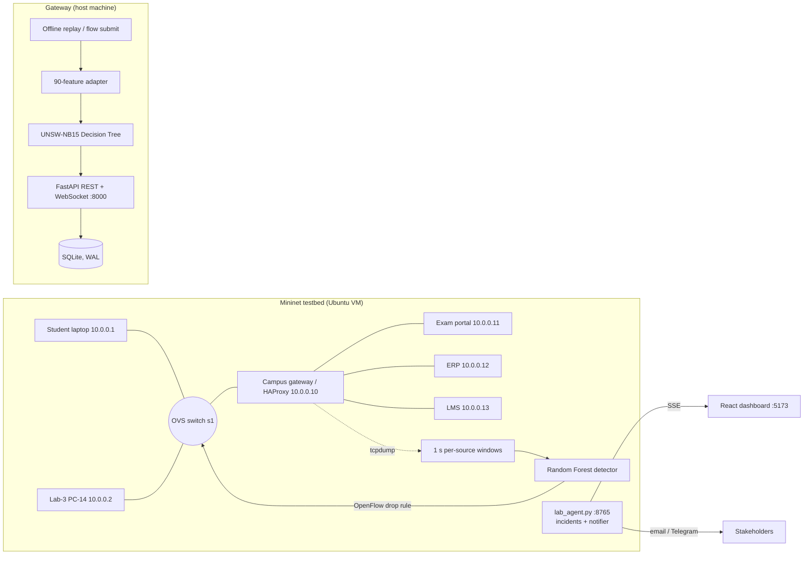

# FlowGuard

**An on-site network guard for campuses: ML-based attack detection, security-aware load balancing and instant alerts**

Cloud DDoS protection (Cloudflare, AWS Shield) guards the front door from the internet. It never sees attacks that start *inside* the network: an infected lab PC flooding the exam server, or a compromised device scanning the LAN. FlowGuard sits in front of your internal servers and does the following:
- detects attacks in about a second with an ML model
- blocks the source at the switch
- keeps services fast by balancing load away from struggling servers
- tells the right people in plain English, by email, Telegram and on the dashboard

▶ **Demo video:** https://www.youtube.com/watch?v=wdtV-RWr1j8

---

## Highlights

| Result | Value |
|---|---|
| Least connections vs. round robin (one back-end slowed by 100 ms) | mean response **68.8 ms → 7.2 ms** |
| Lab-native Random Forest (5-fold grouped CV, 1,725 windows) | **F1 1.000**, FPR 0.0%, 3.3 ms per window |
| UDP flood on a 10 Mbit/s uplink: time to block the attacker | **1.18 s**, 0 false blocks |
| Legitimate mean response time during the flood | **269.4 ms** (no defence) → **7.1 ms** (with detection) |
| UNSW-NB15 baseline Decision Tree (90 features) | F1 0.9802 (documented), < 15 ms inference |

All testbed numbers come from a single run per configuration in an emulated network. Treat them as relative comparisons, not production benchmarks.

---

## Dashboard

A React 19 + TypeScript app with no UI libraries beyond React. Icons and charts are inline SVG.

| Page | What it shows |
|---|---|
| **Overview** | Protection status, attacks blocked, median time to block, live response time, service health, recent incidents |
| **Incidents** | Every detected attack; the detail page has a plain-English summary, timeline, evidence, before/during/after impact, who was notified, and Acknowledge / Unblock / False-positive actions |
| **Network** | Live topology with named campus devices and a device inventory |
| **Services** | Per-server health and request share, load-balancing algorithm, slow-server simulation |
| **Drills** | Launch a UDP/SYN/ICMP flood from a lab machine and watch FlowGuard respond; drill history |
| **Reports** | Weekly summary, "what protection is worth", CSV export, Save as PDF, email report |
| **Settings** | Protection mode, notification rules, device names, detection-engine details |

When the lab agent is not reachable, the dashboard shows demo data based on the measured results, and labels it **Demo data**.

## Alerts

Alerts are routed by severity: each stakeholder receives only the severities ticked for them.

- **Email** (Gmail SMTP): formatted alert with the summary and an "Open incident" link.
- **Telegram:** instant alert with **Acknowledge** and **Unblock source** buttons that act on the incident.
- **Dashboard:** pop-up and bell on every page.

Every incident gets one alert plus a "Resolved" follow-up. Management receives a weekly report only, not every alert. Every delivery is logged. WhatsApp, SMS and voice escalation are on the roadmap.

---

## Architecture



---

## Repository structure

```
├── src/                     React dashboard
│   ├── pages/               Overview, Incidents, IncidentDetail, Network, Services, Drills, Reports, Settings
│   ├── ui/                  Shell (sidebar, top bar, toasts), charts, icons, shared parts
│   ├── state/store.tsx      Live connection to the lab agent (+ demo fallback)
│   ├── api/                 Lab-agent and gateway clients
│   ├── lib/                 Routing, formatting, derived metrics
│   └── styles/app.css       Design system
├── MN_Data/                 Mininet testbed, detector and lab agent
│   ├── lab_agent.py         HTTP + SSE server the dashboard talks to
│   ├── lab_session.py       Runs the lab (real Mininet or --simulate)
│   ├── incidents.py         Turns detections into incidents with plain-English summaries
│   ├── notifier.py          Email + Telegram alerts, routing, delivery log, weekly report
│   ├── .env.example         Template for alert credentials (copy to .env)
│   ├── topo.py · haproxy.cfg · lb_test.py · collect_dataset.py · feature_extractor.py
│   ├── train_lab_model.py · detector.py · run_scenario.py
│   └── *.csv                Collected dataset and experiment results
├── backend/                 FastAPI gateway (UNSW-NB15 model, replay, SQLite, reports, tests)
├── model files/             UNSW-NB15 Decision Tree + encoder + imputer
├── mininet/                 Gateway capture topology, smoke test, PCAP capture
└── docs/                    VM setup, scenarios, feature schema, evaluation, limitations
```

---

## Getting started

### 1. Dashboard

```bash
npm install
npm run dev          # http://localhost:5173
```

### 2. Lab agent (inside the Mininet VM)

```bash
sudo apt install mininet openvswitch-switch haproxy hping3 iperf nmap curl tcpdump
pip3 install scikit-learn pandas joblib
cd MN_Data
python3 train_lab_model.py            # creates model_lab.joblib (once)
sudo python3 lab_agent.py             # real network on port 8765
python3 lab_agent.py --simulate       # no Mininet needed (preview)
```

In VirtualBox, forward **host port 8765 → guest port 8765**. Open the dashboard, go to **Drills**, start monitoring and launch an attack.

### 3. Alerts (optional)

```bash
cp MN_Data/.env.example MN_Data/.env    # add Gmail app password and Telegram bot token
```

Restart the agent. Send `/start` to your Telegram bot to get your chat ID, then add stakeholders in **Settings → Notifications** and press **Send test alert**.

### 4. Gateway backend and experiments

```bash
pip install -r backend/requirements.txt
python -m uvicorn backend.main:app --host 0.0.0.0 --port 8000
python -m unittest discover backend/tests -v

cd MN_Data
sudo mn -c && sudo python3 topo.py --test    # smoke test
sudo python3 lb_test.py                      # round robin vs. least connections
sudo python3 run_scenario.py                 # no attack / flood / defended
```

> ⚠️ Attack traffic (hping3 / nmap) must only be generated inside the isolated Mininet network.

---

## Limitations

- Binary classification only (normal / attack). Attack type in incidents comes from the drill or from traffic features.
- Results come from an emulated, single-switch lab with one run per configuration. Low-rate attacks were not tested.
- Per-source blocking assumes few attacker addresses; distributed or spoofed attacks need aggregate mitigation.
- Mininet needs Linux. On Windows, use `lab_agent.py --simulate` or the gateway's replay engine.

See [`docs/known-limitations.md`](docs/known-limitations.md) and [`docs/troubleshooting.md`](docs/troubleshooting.md).

---

## Team (Group 3, Panel K)

Aviraj Sinha · Kalp Lad · Palash Ranka · Aaradhya Banginwar

Guided by **Dr. Uma Pujeri**, Department of Computer Engineering and Technology, 2026–27.
