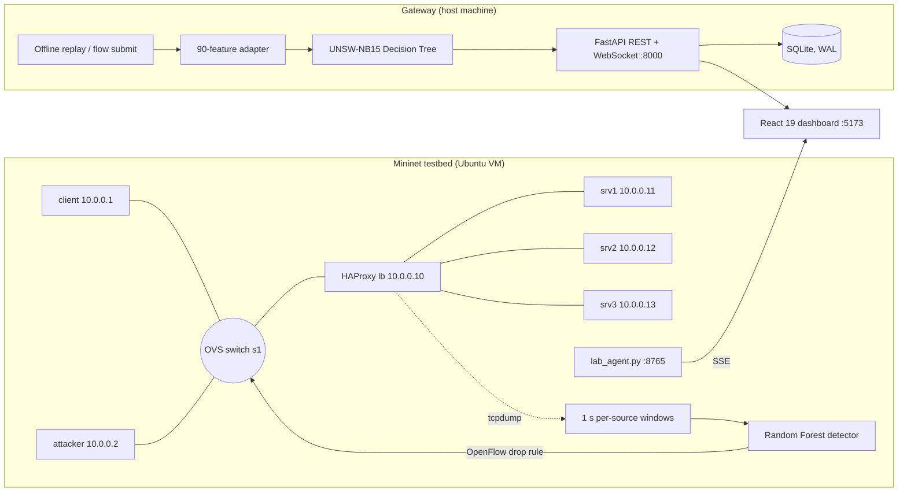

# FlowGuard

**Network traffic monitoring, ML-assisted threat detection and security-aware load balancing**

FlowGuard is a Computer Networks Laboratory (CSE20110) mini project. It puts an ML-based intrusion detector in front of an HAProxy load balancer in a Mininet-emulated network, so flood traffic is blocked at the switch before it reaches the back-ends. A FastAPI gateway and a React dashboard stream, store and visualise the classified traffic.

▶ **Demo video:** https://www.youtube.com/watch?v=wdtV-RWr1j8

---

## Highlights

| Result | Value |
|---|---|
| Least connections vs. round robin (one back-end slowed by 100 ms) | mean response **68.8 ms → 7.2 ms** |
| Lab-native Random Forest (5-fold grouped CV, 1,725 windows) | **F1 1.000**, FPR 0.0%, 3.3 ms per window |
| UDP flood on a 10 Mbit/s LB uplink: time to block the attacker | **1.18 s**, 0 false blocks |
| Legitimate mean response time during the flood | **269.4 ms** (no defence) → **7.1 ms** (with detection) |
| UNSW-NB15 baseline Decision Tree (90 features) | F1 0.9802 (documented), < 15 ms inference |
| Automated backend tests | 35 tests across 8 modules |

All testbed numbers come from a single run per configuration in an emulated network. Treat them as relative comparisons, not production benchmarks.

---

## Architecture



- **Testbed:** one Open vSwitch learning switch (no controller), a legitimate client, an attacker, an HAProxy load balancer (round robin or least connections) and three web back-ends.
- **Lab-native detector:** nine features per source per 1-second window (packets, bytes, mean size, SYN ratio, distinct src/dst ports, TCP/UDP/ICMP share). A source classified as ATTACK is blocked with an `ovs-ofctl` drop rule on `s1`.
- **Gateway:** FastAPI service that scores flows with the UNSW-NB15 Decision Tree, persists events to SQLite and pushes them over WebSocket. The gateway itself only **flags** flows; blocking happens in the testbed.
- **Dashboard:** the **Lab** view controls and watches the Mininet testbed through `lab_agent.py`, and the **Monitor** view shows gateway traffic, back-end health, topology and the security feed.

---

## Repository structure

```
├── backend/                 FastAPI gateway
│   ├── main.py              REST + WebSocket endpoints
│   ├── model_pipeline.py    90-feature adapter, encoder, imputer, classifier
│   ├── flow_adapter.py      Pure-Python PCAP → bidirectional flow records
│   ├── feature_mapping.py   Flow records → UNSW-NB15 schema with provenance
│   ├── evaluation.py        Confusion matrix, F1, FPR, Wilson CIs, gates
│   ├── report_generator.py  JSON / CSV / HTML experiment reports
│   ├── database.py          SQLite (WAL) events, experiments, audit log
│   ├── replay.py            Offline replay engine
│   ├── fixtures/            Verified benign / attack flow records
│   └── tests/               unittest suites
├── model files/             UNSW-NB15 Decision Tree + encoder + imputer (.joblib)
├── MN_Data/                 Mininet load-balancing & detection testbed
│   ├── topo.py              Topology + smoke test
│   ├── haproxy.cfg          Load balancer config
│   ├── lb_test.py           Round robin vs. least connections experiment
│   ├── collect_dataset.py   Labelled benign/attack traffic collection
│   ├── feature_extractor.py tcpdump → 1 s window features
│   ├── train_lab_model.py   DT / RF / XGBoost comparison → model_lab.joblib
│   ├── detector.py          Live scoring + switch-level blocking
│   ├── run_scenario.py      No-attack / flood / defended experiments
│   ├── lab_session.py       Interactive lab session used by the agent
│   ├── lab_agent.py         HTTP + SSE server the dashboard talks to
│   └── *.csv                Collected dataset and experiment results
├── mininet/                 Gateway capture topology, smoke test, PCAP capture
├── src/                     React 19 + TypeScript dashboard
│   ├── components/lab/      Lab view (topology, controls, LB, detector, charts)
│   ├── components/          Monitor view panels
│   ├── api/                 Gateway and lab-agent clients
│   └── hooks/useLab.ts
├── docs/                    VM setup, scenarios, feature schema, evaluation, limitations
├── package.json / vite.config.ts / tsconfig*.json
└── backend/requirements.txt
```

---

## Getting started

### Prerequisites

- Python 3.11 or 3.12 and Node.js 18+ on the host machine
- For the testbed: the Mininet 2.3 VM (Ubuntu 20.04) in VirtualBox, with Python 3.8+

### 1. Gateway backend

```bash
pip install -r backend/requirements.txt
python -m uvicorn backend.main:app --host 0.0.0.0 --port 8000

# check it is up
curl http://localhost:8000/api/v1/health
```

### 2. Dashboard

```bash
npm install
npm run dev          # http://localhost:5173
npm run build        # type-check (tsc -b) + production bundle
npm run lint
```

The default URLs can be overridden with `VITE_API_BASE_URL`, `VITE_WS_BASE_URL` and `VITE_LAB_URL` in a `.env.local` file.

### 3. Mininet testbed (inside the VM)

Copy the `MN_Data/` folder into the VM, then:

```bash
sudo apt install mininet openvswitch-switch haproxy hping3 iperf nmap curl tcpdump
pip3 install scikit-learn pandas joblib      # xgboost is optional

cd MN_Data
sudo mn -c && sudo python3 topo.py --test    # expect: SMOKE TEST PASSED
sudo python3 lb_test.py                      # → results_lb.csv
sudo python3 collect_dataset.py              # → dataset_lab.csv (optional, dataset is included)
python3 train_lab_model.py                   # → model_lab.joblib, results_model.csv
sudo python3 run_scenario.py                 # → results_scenarios_10M.csv, results_timeline_10M.csv
sudo python3 run_scenario.py --lb-bw 100     # 100 Mbit/s control run
```

`model_lab.joblib` is not committed. Run `train_lab_model.py` once before using the detector, the scenarios or the lab agent.

### 4. Live lab in the dashboard

```bash
# inside the VM
sudo python3 lab_agent.py            # real Mininet lab on port 8765
python3 lab_agent.py --simulate      # preview mode, no Mininet needed
```

In VirtualBox, forward **host port 8765 → guest port 8765**, then open the **Lab** view in the dashboard to start sessions, switch the balancing algorithm, toggle defence and launch attacks.

> ⚠️ Attack traffic (hping3 / nmap) must only be generated inside the isolated Mininet network.

---

## Tests

```bash
python -m unittest discover backend/tests -v
```

| Module | Covers |
|---|---|
| `test_model_pipeline` | 90-feature shape, categorical encoding, imputation, classification |
| `test_api` | REST validation, predict / batch predict, snapshot, fault injection |
| `test_e2e_replay` | Replay lifecycle, SQLite persistence, WebSocket delivery |
| `test_feature_schema` | Feature ordering and provenance tiers |
| `test_flow_adapter` | PCAP parsing and flow construction |
| `test_evaluation` | Metrics, confidence intervals, unlabeled-data handling |
| `test_experiments_api` | Experiment registration and report export |
| `test_mininet_config` | Topology addressing and configuration |

Testbed experiments T18–T24 (smoke test, load balancing, model CV, flood with and without defence) are run with the `MN_Data` scripts above.

---

## Gateway API

| Method | Endpoint | Description |
|---|---|---|
| `GET` | `/api/v1/health` | Service status and model readiness |
| `GET` | `/api/v1/model/info` | Feature contract, classes, tree depth |
| `POST` | `/api/v1/flows/predict` | Score a single flow (stored and broadcast) |
| `POST` | `/api/v1/flows/predict_batch` | Score up to 100 flows |
| `POST` | `/api/v1/flow/submit` | Ingest a captured flow with ground truth |
| `GET` | `/api/v1/dashboard/snapshot` | Aggregate counts, back-end health, recent events |
| `GET` | `/api/v1/events` | Paginated, filterable event history |
| `POST` | `/api/v1/lab/backends/{id}/fail` | Simulated back-end fault injection |
| `GET/POST` | `/api/v1/experiments` | List / register experiment runs |
| `GET` | `/api/v1/experiments/{id}/report` | Report as `json`, `csv` or `html` |
| `POST` | `/api/v1/replay/start` · `/stop` | Control the offline replay engine |
| `WS` | `/api/v1/events/stream` | Live event stream with ping/pong heartbeat |

Lab agent (`MN_Data/lab_agent.py`, port 8765): `GET /api/lab/health`, `/status`, `/stream` (SSE), `/history` · `POST /api/lab/start`, `/command`, `/stop`, `/history/clear`.

---

## Limitations

- Binary classification only (NORMAL / ATTACK).
- Results are from an emulated, single-switch lab with one run per configuration. The near-perfect lab scores reflect easily separable floods, and low-rate attacks were not tested.
- Per-source blocking assumes few attacker addresses, so distributed or spoofed attacks need aggregate mitigation.
- The UNSW-NB15 baseline was not evaluated on lab traffic because its features cannot be derived from the lab windows.
- Mininet needs Linux. On Windows, use the replay engine or `lab_agent.py --simulate`.

See [`docs/known-limitations.md`](docs/known-limitations.md) and [`docs/troubleshooting.md`](docs/troubleshooting.md) for details.

---

## Documentation

- [VM setup](docs/vm-setup.md)
- [Traffic scenarios](docs/scenarios.md)
- [Feature schema](docs/feature-schema.md)
- [Evaluation methodology](docs/evaluation-methodology.md)
- [Mininet implementation plan](docs/mininet-implementation-plan.md)
- [Troubleshooting](docs/troubleshooting.md)
- [Known limitations](docs/known-limitations.md)

---

## Team (Group 3, Panel K)

Aviraj Sinha · Kalp Lad · Palash Ranka · Aaradhya Banginwar

Guided by **Dr. Uma Pujeri**, Department of Computer Engineering and Technology, 2026–27.

Built with FastAPI, scikit-learn, React, Vite, Recharts, Mininet, Open vSwitch and HAProxy. Baseline model trained on the [UNSW-NB15](https://research.unsw.edu.au/projects/unsw-nb15-dataset) dataset.
