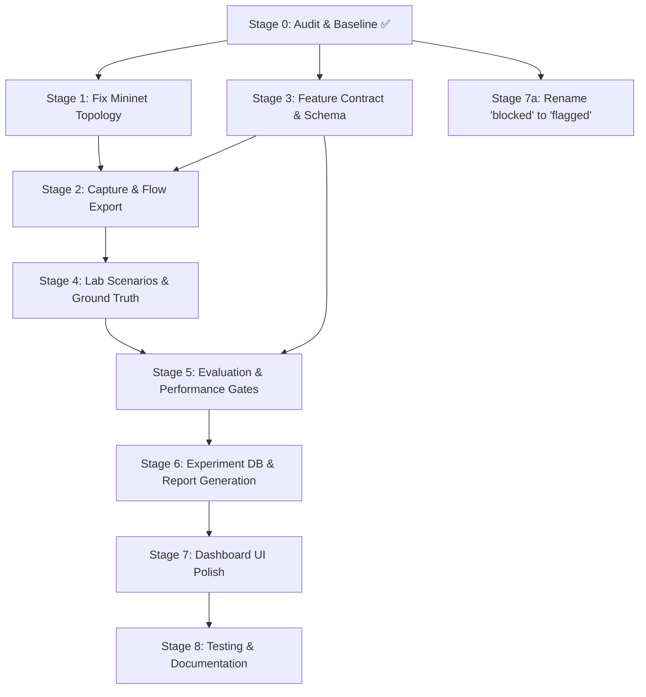

# FlowGuard — Mininet Lab Implementation Plan

> **Generated**: 2026-10-20 | **Author**: FlowGuard Senior Engineering Team  
> **Repository**: `aviraj05/FlowGuard` | **Status**: Stage 0 complete, implementation in progress

---

## Stage 0 — Repository Audit Results (COMPLETE)

### Architecture Summary

| Layer | Technology | Key Files |
|---|---|---|
| Frontend | React 19 + TypeScript + Vite | `src/App.tsx`, 6 components, `src/api/client.ts` |
| Backend | FastAPI (Python 3.12) | `backend/main.py`, `backend/model_pipeline.py` |
| Database | SQLite | `backend/database.py` → `events`, `lab_audit` tables |
| ML Model | scikit-learn DecisionTree | `model files/best_model.joblib` + encoder + imputer |
| Feature Pipeline | Custom `UNSWFeatureExtractor` | `model files/feature_extraction.py` (90 features) |
| Real-time | WebSocket (ping/pong heartbeat) | `backend/websocket_manager.py` |
| Replay | Offline flow replay engine | `backend/replay.py` (5 fixture flows) |
| Mininet | Python topology + bash scenarios | `mininet/topology.py`, `mininet/traffic_scenarios.sh` |

### Installed Runtime vs. Artifact Versions

| Component | Runtime | Artifact | Status |
|---|---|---|---|
| Python | 3.12.5 | Unknown | ✅ OK |
| scikit-learn | **1.5.2** | **1.8.0** | ⚠️ Version mismatch (InconsistentVersionWarning) |
| numpy | 2.2.6 | Unknown | ✅ OK |
| pandas | 2.2.3 | Unknown | ✅ OK |
| joblib | 1.4.2 | Unknown | ✅ OK |

**Verdict**: All 3 artifacts (`best_model.joblib`, `categorical_encoder.joblib`, `missing_value_imputer.joblib`) were serialized with scikit-learn **1.8.0** but load into runtime **1.5.2** with `InconsistentVersionWarning`. Despite warnings, inference produces stable, expected outputs on all fixture records. This is logged and recorded as a known risk without suppressing warnings.

### Model Artifact Hashes (SHA-256)

| Artifact | SHA-256 |
|---|---|
| `best_model.joblib` | `08ba76cecf631b1429dd1ec3f1c24f682f6e9bc1aa66185347b4df855ec59842` |
| `categorical_encoder.joblib` | `60e132194b6ce3996727289f078bb09200424a1e9ce756bb0fc0c3a51e60b3ec` |
| `missing_value_imputer.joblib` | `538e0da681be93be8192a5ee11f059cb2ad9f57ebbfdf5dfbe4ebef1e14994f2` |
| `metadata.json` | `a5f106deaa49a6071ea00445a6c11d4eb3f868ad94d6e902b28c8959f9e01e0f` |

### Baseline Prediction Contract (Verified)

| Fixture | Label | Label Name | Attack Prob | Action |
|---|---|---|---|---|
| `BENIGN_WEB_FLOW` | 0 | NORMAL | 0.0 | ALLOW |
| `BENIGN_DNS_FLOW` | 0 | NORMAL | 0.0 | ALLOW |
| `ATTACK_RECON_FLOW` | 1 | ATTACK | 1.0 | ALERT |

### Model Metadata

- **Classifier**: Decision Tree, max_depth=20, 5861 nodes, 2931 leaves
- **Encoder**: OrdinalEncoder for `proto` (135 values), `state` (16), `service` (13)
- **Imputer**: SimpleImputer (median strategy), 90 features
- **Historical F1**: 0.9802 — **UNVERIFIED** (training data `data/unsw_nb15.csv` not bundled)
- **Training code**: `model files/preprocessing_usage.py` references training data but data is absent

### Existing Test Suite (17 tests — ALL PASS)

- `test_model_pipeline.py` — 7 tests (contract, labels, predictions, batch, unverified claims)
- `test_api.py` — 9 tests (health, model info, predict, batch, snapshot, events, lab fail, replay)
- `test_e2e_replay.py` — 1 test (full vertical slice: API → model → DB → snapshot → WebSocket)

### Identified Risks

| # | Risk | Severity | Mitigation |
|---|---|---|---|
| 1 | **Topology subnet mismatch**: Client `192.168.1.100/24` and backends `10.0.0.x/24` are on different subnets behind one L2 switch, with non-existent gateways | **CRITICAL** | Fix: same subnet `10.0.0.0/24` for all hosts behind switch |
| 2 | **sklearn version mismatch**: Artifacts from 1.8.0 loaded in 1.5.2 | **MEDIUM** | Predictions verified stable; log + monitor |
| 3 | **No flow exporter**: No pipeline from PCAP → 90-feature schema | **HIGH** | Build explicit adapter with provenance |
| 4 | **Default fields mask missing data**: `FlowRecordInput` defaults (0, "tcp", "CON") fill absent fields silently | **MEDIUM** | Track provenance per feature |
| 5 | **Unverified F1 score**: 0.9802 from metadata, training data absent | **LOW** | Already flagged as unverified in API |
| 6 | **"blocked" UI wording**: Frontend maps attacks to "blocked" but no blocking occurs | **MEDIUM** | Rename to "flagged" |
| 7 | **Orphan processes**: Topology starts `http.server` with `&` but never kills them | **MEDIUM** | Add proper PID tracking and cleanup |

---

## Stage 1 — Repair and Validate Mininet Topology

### Changes
1. **Fix addressing**: Put all hosts on `10.0.0.0/24` subnet (client=`10.0.0.100`, backends=`10.0.0.1-3`).
2. **Remove broken default routes** (no router exists on L2 switch).
3. **Make topology configurable**: Extract addresses, bandwidth, ports to a config dictionary.
4. **Add reliable server start/stop**: Use PID tracking and explicit kill on cleanup.
5. **Add smoke test script**: Python script that starts topology, runs `pingall`, HTTP checks, then exits cleanly.
6. **Document Linux/VM requirements**: VirtualBox setup guide with host-only interface.

### Acceptance Criteria
- [ ] `pingall` succeeds (0% packet loss)
- [ ] Client can `curl` each backend on port 80
- [ ] Cleanup kills all server processes
- [ ] Smoke test exits 0 on success

---

## Stage 2 — Capture and Flow Export

### Changes
1. **Capture runner** (`mininet/capture.py`): Starts `tcpdump` on the switch interface, saves PCAPs to `experiments/<run_id>/`.
2. **Flow adapter** (`backend/flow_adapter.py`): Converts PCAP → bidirectional flow records using packet parsing.
3. **Feature mapping layer** (`backend/feature_mapping.py`): Maps raw flow fields to the 90-feature UNSW-NB15 schema with explicit provenance tracking.
4. **Counters**: packets_seen, flows_created, flows_emitted, exporter_errors, dropped_unusable.

### Acceptance Criteria
- [ ] A benign HTTP request creates a PCAP with ≥1 flow record.
- [ ] Flow records include IP/port/proto/duration/bytes/packets.
- [ ] Schema validation rejects malformed records with useful errors.
- [ ] Exporter logs missing field counts.

---

## Stage 3 — Feature Contract and Model Safety

### Changes
1. **Schema source of truth** (`backend/feature_schema.py`): Single versioned definition of all 90 features with types, valid ranges, and provenance expectations.
2. **Pre-inference validation**: Check feature count, port ranges, non-negative counters, finite values, known categories.
3. **Per-flow provenance**: Each feature tagged as `measured`, `derived`, `imputed`, or `unavailable`.
4. **Quality gate**: Configurable max imputation rate (default 60%); flows exceeding it are marked `insufficient_quality`.
5. **Unknown category handling**: Verify encoder behavior for unseen proto/state/service values without crashing.
6. **Edge cases**: Zero-duration flows, UDP flows, reversed direction, empty captures.

### Acceptance Criteria
- [ ] Unit tests verify feature order matches model expectations.
- [ ] Unknown categories handled without crash.
- [ ] Flows with excessive imputed features are flagged.
- [ ] Baseline predictions remain stable.

---

## Stage 4 — Repeatable Lab Scenarios and Ground Truth

### Changes
1. **Scenario runner** (`mininet/scenario_runner.py`):
   - `benign_http` — HTTP GETs to backends
   - `benign_repeated` — controlled-rate connections
   - `port_scan` — low-rate nmap/syn scan against backend
   - `server_failure` — backend stops responding
2. **Run manifest**: JSON file per run with scenario_id, timestamps, target_hosts, rate/duration, expected_label.
3. **Ground truth storage**: Separate from predictions; linked by run_id + flow matching rules.
4. **`unknown` label**: Valid ground-truth state for ambiguous flows.

### Acceptance Criteria
- [ ] Repeated scenario creates new run with unique ID.
- [ ] Ground truth is independent of model predictions.
- [ ] Run manifest is human-readable and version-controlled.

---

## Stage 5 — Model Evaluation and Performance Gates

### Two Evaluation Tracks
- **Track A (Static Regression)**: Historical F1 (0.9802) cannot be independently reproduced without original training data.
- **Track B (Mininet Scenario Evaluation)**: Compare predictions vs. independent ground-truth labels.
- Metrics: Confusion matrix, accuracy, balanced accuracy, precision, recall, FPR, F1, support/count.
- Target gates (provisional): FPR ≤ 5%, Attack Recall ≥ 80%, Balanced Accuracy ≥ 80%.

### Acceptance Criteria
- [ ] Synthetic labels produce expected confusion matrix.
- [ ] No "passed" status without sufficient labeled data.
- [ ] Missing gates clearly labeled.

---

## Stage 6 — Experiment Storage and Report Generation

### Database Migrations
- `experiment_runs` table: run_id, scenario_id, start/end time, config, status
- `flow_ground_truth` table: flow_id, run_id, ground_truth_label
- `flow_evaluations` table: flow_id, prediction, score, model_version, feature_provenance
- Preserve existing `events` and `lab_audit` tables

### Report APIs
- `GET /api/v1/experiments` — list runs
- `GET /api/v1/experiments/{run_id}/report` — generate report (JSON, CSV, printable HTML)

### Acceptance Criteria
- [ ] Report downloadable for completed run.
- [ ] Unlabeled run shows "metrics unavailable".
- [ ] Existing event history preserved.

---

## Stage 7 — Dashboard Polish and Honest Modes

### Changes
1. Preserve Demo + Replay modes.
2. Rename "blocked" → "flagged" throughout frontend for honest wording.
3. Add Mininet Lab mode to UI:
   - Capture health indicator
   - Current experiment/run ID
   - Packets/flows/errors counters
   - Feature coverage indicator
   - Live events with source label (`demo`, `replay`, `mininet_capture`)
4. Evaluation summary panel and report generation modal/buttons.

### Acceptance Criteria
- [ ] Frontend builds and lint passes.
- [ ] Demo and Replay still work.
- [ ] "No labels" never shows as "0% accuracy".
- [ ] All events show source type.

---

## Stage 8 — Testing, Documentation, and Final Demo

### Coverage
- Automated backend tests for all new modules.
- Documentation: README, VM setup, scenarios, feature schema, evaluation methodology, troubleshooting, limitations.
- Verification on Windows (backend, frontend, adapter, evaluation, report) + documented VM instructions for Mininet execution.

---

## Implementation Dependency Graph

